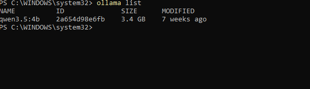
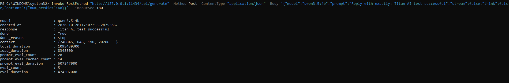

# 🤖 AI & Models - Evidence

This page documents evidence of local AI model deployment, Ollama API functionality, and experimentation with Qwen.

## 1. Ollama Model Inventory

Ollama running on the HP laptop with the `qwen3.5:4b` model installed.

## 2. Successful AI Inference

A REST API request to Ollama successfully generated the expected response: `Titan AI test successful`.

## 3. Model Configuration

The installed model uses GGUF format with Q4_K_M quantisation. The Ollama API confirmed the model was loaded and capable of generating a response.

## 4. Atlas Homelab Assistant

Atlas is an ongoing project integrating a local language model with homelab information through an API. Its goal is to provide useful responses grounded in real infrastructure data.
