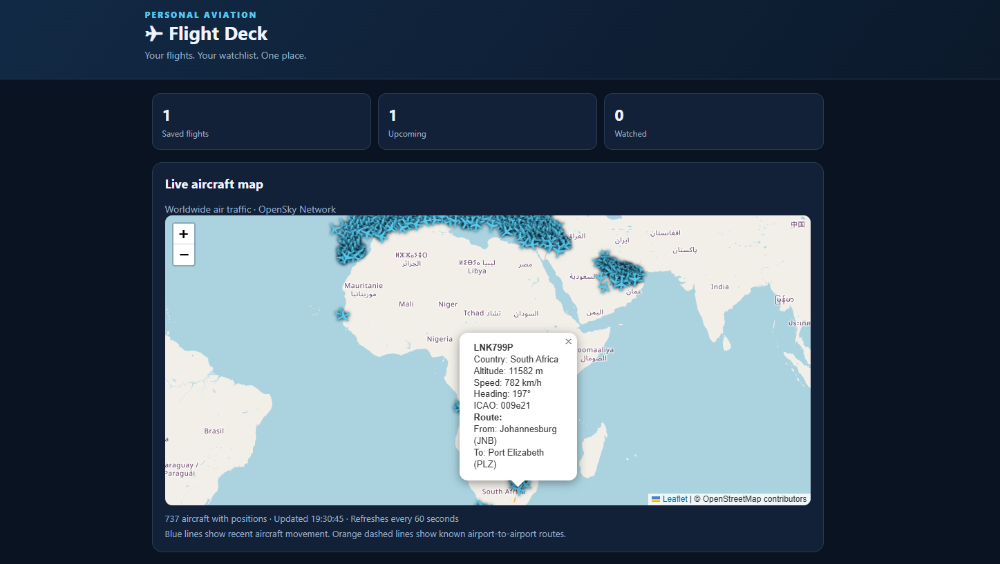
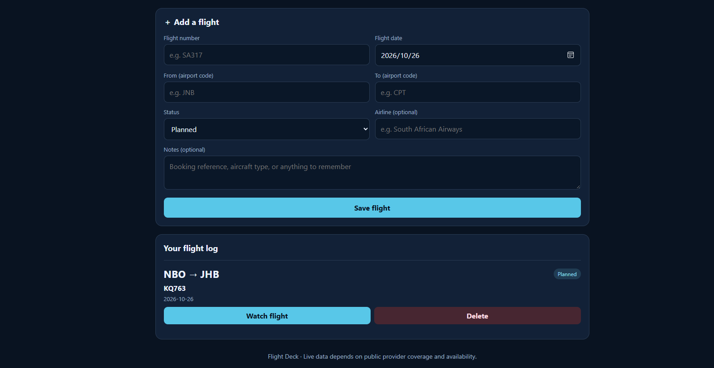

# ✈️ Flight Deck - Evidence

## 1. Flight Deck Dashboard

The main Flight Deck interface for managing and viewing flight information.

## 2. Saved Flights

The saved flights interface, allowing users to view flights they have added to the application.

## Project Details

Flight Deck is a self-hosted aviation tracking application built with a Python web application and SQLite database. It is deployed using Docker and is designed to support personal flight tracking, saved flights, and flight-status management.

The application includes flight statuses such as Planned, Watching, Departed, Landed, and Cancelled.
