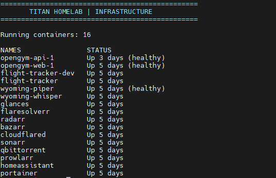
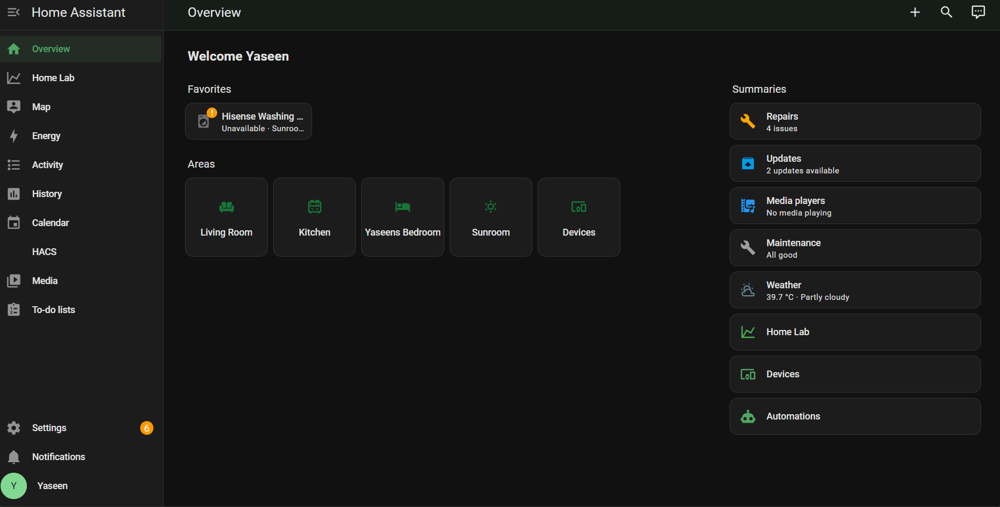
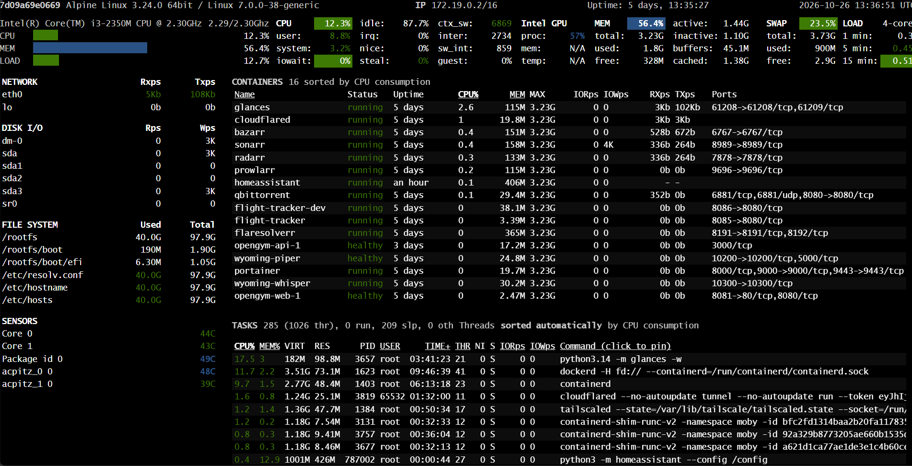
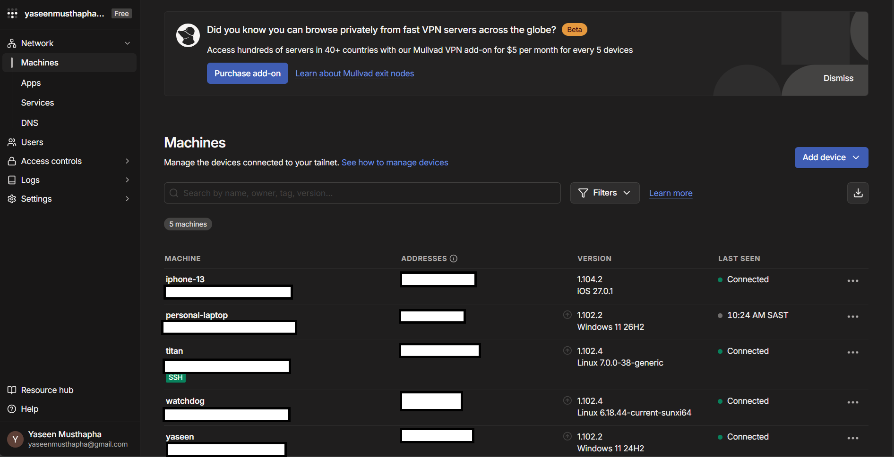

# Titan Homelab - Infrastructure Evidence

Personal Linux-based homelab used to deploy, manage and maintain self-hosted applications and services.

**Stack:** Linux · Docker · Docker Compose · Home Assistant · Glances · Tailscale

## 1. Docker - Container Infrastructure

Shows running containers and self-hosted services managed through Docker.

## 2. Home Assistant - Homelab Dashboard

Shows the Home Assistant dashboard and relevant monitoring entities.

## 3. Glances - System Monitoring

Shows system resource usage and performance metrics from the homelab.

## 4. Tailscale - Remote Access

Demonstrates remote connectivity to the homelab.

## 5. Home Assistant - Alert Notifications

Shows an example of a homelab alert delivered through Home Assistant persistent notifications.

---

