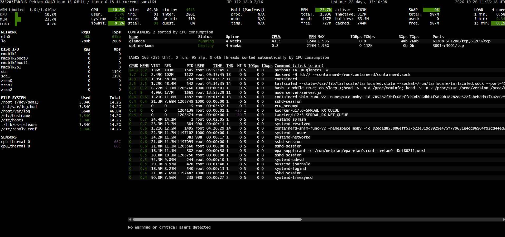
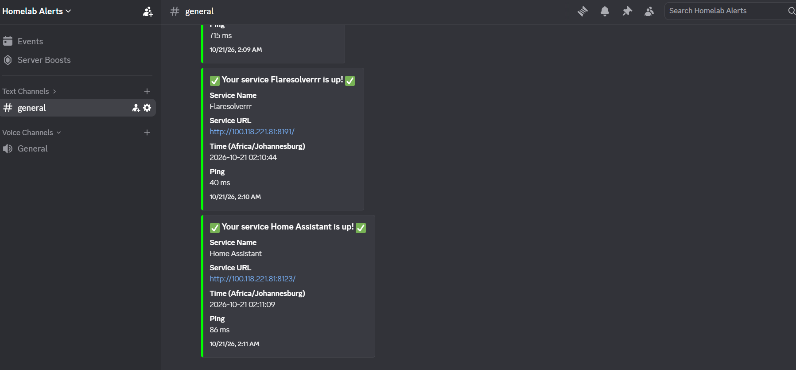

# Watchdog - Monitoring Evidence

Dedicated monitoring node running on an Orange Pi 3 LTS.

**Stack:** Uptime Kuma · Glances · Discord

## 1. Uptime Kuma - Service Availability

Shows monitored services and their availability status.

## 2. Glances - System Monitoring

Shows system resource usage and metrics from the monitoring node.

## 3. Discord - Alert Notifications

Shows a real monitoring notification delivered through Discord.

---
