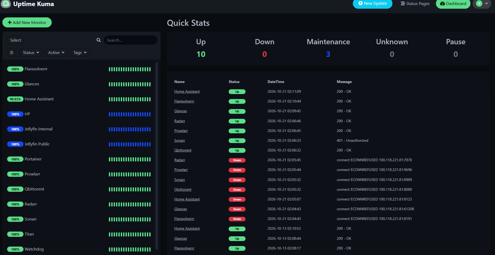

# Watchdog — Monitoring Evidence

Dedicated monitoring node running on an Orange Pi 3 LTS.

**Stack:** Uptime Kuma · Glances · Discord

## 1. Uptime Kuma — Service Availability

Shows monitored services and their availability status.

*Screenshot pending.*

## 2. Glances — System Monitoring

Shows system resource usage and metrics from the monitoring node.

*Screenshot pending.*

## 3. Discord — Alert Notifications

Shows a real monitoring notification delivered through Discord.

*Screenshot pending.*

---

*Screenshots will be added after capturing the running services. No sample or simulated monitoring results are presented as live evidence.*
