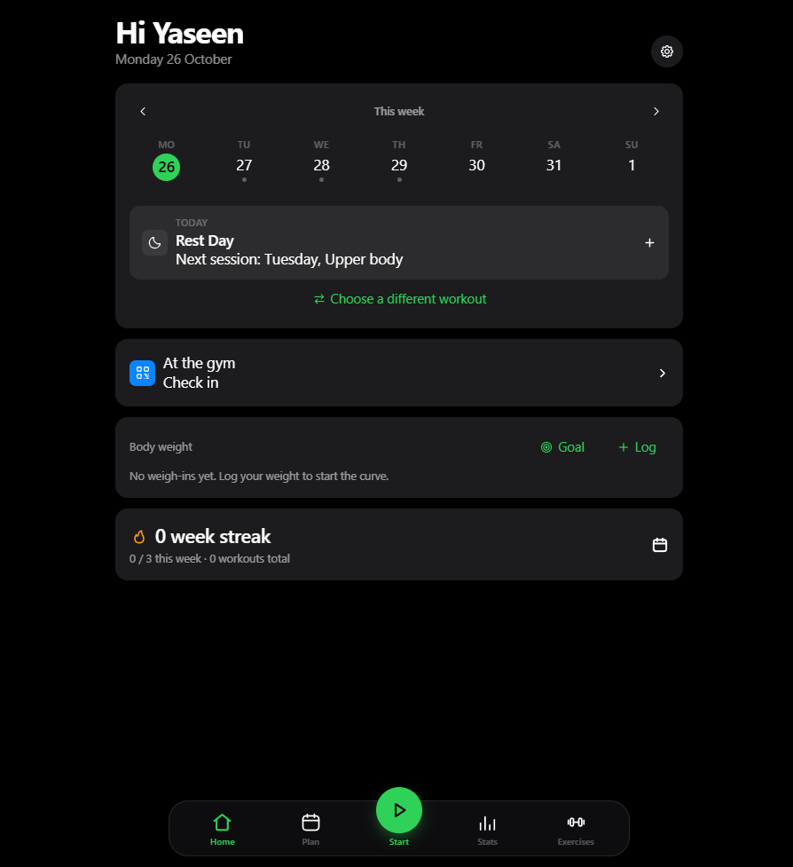
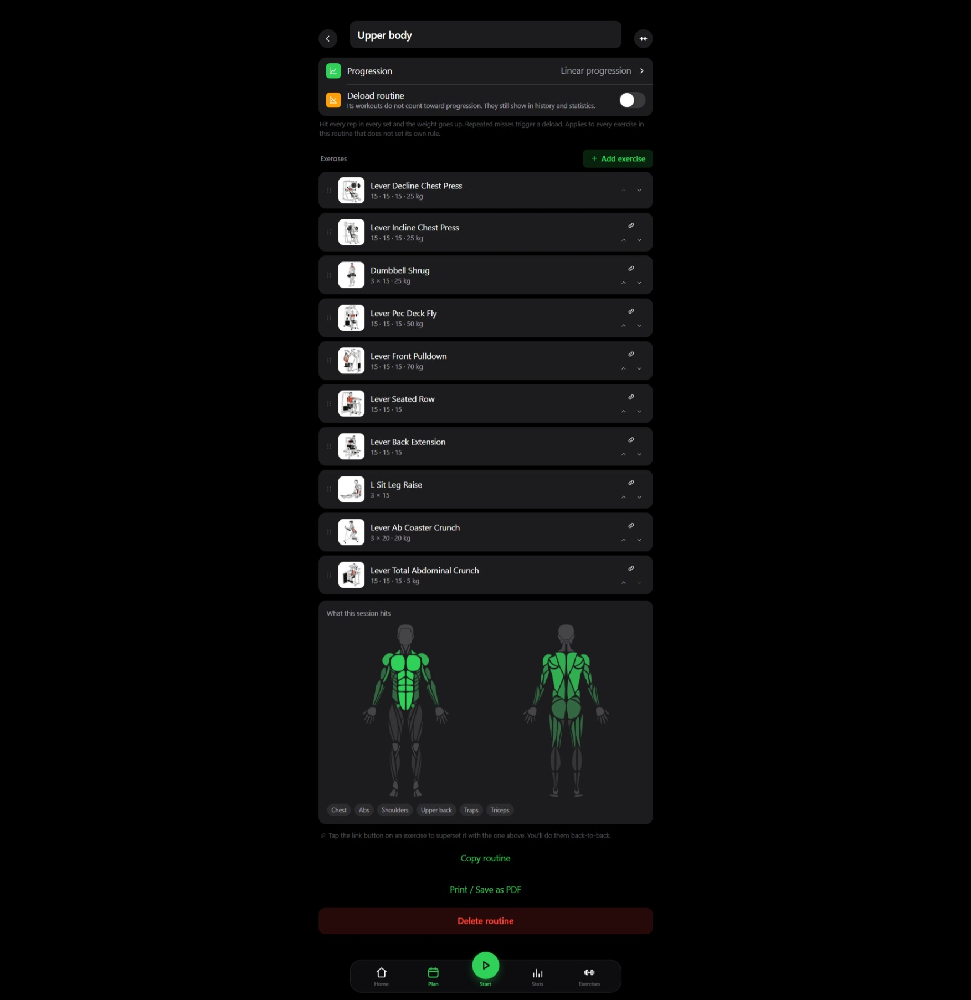

# 💪 openGym - Evidence

## 1. Application Dashboard

The main interface of openGym, my self-hosted workout and bodyweight tracking application.

## 2. Workout Tracking

The workout tracking interface, demonstrating the application's fitness tracking functionality.

## Project Overview

openGym is a personal fitness application deployed on my homelab using Docker Compose.

The deployment separates the web frontend from the API service and is configured to run on my own infrastructure.

### Technologies

- Docker Compose
- Web frontend
- API service
- Self-hosted infrastructure

### Project Goals

- Track personal workouts and bodyweight training.
- Run a fitness application on my own infrastructure.
- Practise containerised application deployment and service management.
